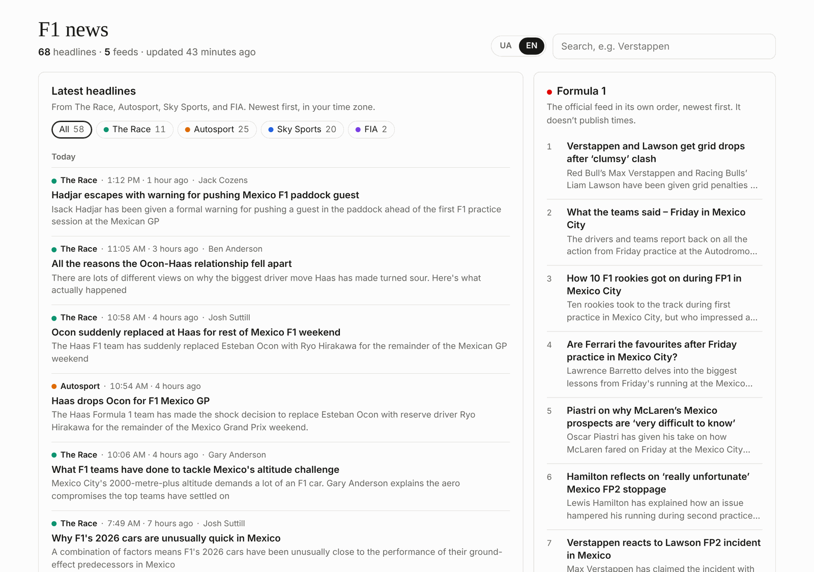

# F1 news

A small dashboard with the latest Formula 1 headlines from five feeds: Formula1.com, the FIA, The Race, Autosport and Sky Sports. It is a static site for GitHub Pages. A scheduled GitHub Action plays the part of the backend.



The page opens in Ukrainian and has a UA / EN switch. Headlines are translated on your own device by Chrome's built-in translator (see [Languages](#languages)).

## How it works

- `scripts/fetch_feeds.py` reads the RSS feeds listed in `feeds.json` and writes `site/data/news.json`. It uses only the Python standard library and reads structured XML, so there is no HTML scraping.
- `.github/workflows/update-and-deploy.yml` runs it every 30 minutes. When the headlines change, it commits `site/data/news.json` and deploys `site/` to GitHub Pages.
- `site/` is plain HTML, CSS and JavaScript with no build step. It loads `data/news.json`, checks for new headlines every 5 minutes, and lets you filter by source and search. The page text comes in Ukrainian and English.

```
feeds (RSS) ──> GitHub Action, every 30 min ──> site/data/news.json ──> GitHub Pages ──> browser
                scripts/fetch_feeds.py           (committed)            site/
```

## Sources

| Feed | Notes |
|---|---|
| [The Race](https://the-race.com/category/formula-1/feed/) | Full articles in the feed, updated often |
| [Autosport](https://www.autosport.com/rss/f1/news/) | |
| [Sky Sports](https://www.skysports.com/rss/12433) | Items are not in date order; the page sorts them |
| [FIA press releases](https://www.fia.com/rss/press-release) | Covers every FIA series; `include` in `feeds.json` keeps the F1 ones |
| [Formula1.com](https://www.formula1.com/en/latest/all.xml) | Official, but the feed has no publish times, so it gets its own column in feed order |

To add or remove a feed, edit `feeds.json`. RSS 2.0, RSS 1.0 and Atom all work. Optional keys: `official`, `include` (a regex the title or summary must match) and `timeline: false` (show the feed in its own column instead of the timeline).

## Languages

- The page opens in Ukrainian. The UA / EN switch in the header changes the page text and the headlines, and the choice is remembered (`?lang=en` in the address works too).
- In Ukrainian, headlines and summaries are translated in the browser with Chrome's built-in [Translator API](https://developer.chrome.com/docs/modern-web-guidance/guides/built-in-ai/translator) (Chrome 138+ or Edge 148+ on desktop). There is no key, no cost and no server: the text never leaves the device.
- The first time, the page shows a "Перекласти новини українською" button, because Chrome has to download the English to Ukrainian model once and only does that after a click. After that, translation starts on its own.
- Translations are kept in `localStorage`, so only new headlines are translated on later visits. Hovering a translated headline shows the English original.
- Other browsers (Safari, Firefox, phones) show the Ukrainian page with English headlines and a short note that says why.

All page text lives in the `TEXT` object at the top of `site/app.js`.

## Run it locally

```sh
python3 scripts/fetch_feeds.py              # refresh site/data/news.json
python3 -m http.server 8000 --directory site
# open http://localhost:8000
python3 -m unittest discover -s tests       # tests for the feed parser
```

## Deploy to GitHub Pages

GitHub Pages is free for public repositories. With the [GitHub CLI](https://cli.github.com/):

```sh
gh repo create f1-news-dashboard --public --source . --remote origin
gh api -X POST "repos/{owner}/{repo}/pages" -f build_type=workflow   # Pages source: GitHub Actions
git push -u origin main
```

The push starts the workflow, which fetches fresh headlines and publishes the site at `https://<your-user>.github.io/f1-news-dashboard/`. You can also run it by hand from the Actions tab (Update news and deploy, then Run workflow).

Without the CLI: create the repository on github.com, set Settings > Pages > Source to GitHub Actions, then add the remote and push.

## Data format

`site/data/news.json`:

```jsonc
{
  "version": 1,
  "generated_at": "2026-10-31T17:50:00Z",      // when the headlines last changed
  "sources": [
    { "key": "therace", "name": "The Race", "site": "...", "feed": "...",
      "official": false, "timeline": true, "ok": true, "error": null, "count": 11 }
  ],
  "items": [
    { "id": "therace-1a2b3c4d5e6f", "source": "therace", "title": "...", "url": "...",
      "published": "2026-10-31T17:12:41Z",          // null when the feed has no date
      "first_seen": "2026-10-31T17:50:00Z",         // when the fetcher first saw it
      "author": "Jack Cozens", "summary": "...", "image": null, "rank": 1 }
  ]
}
```

A feed that fails keeps its earlier items and gets `"ok": false`; the page then shows a note.

## Adding a backend later

The page only needs a URL that returns the JSON above. To move off the committed file, run the same fetcher on a server (`build()` in `scripts/fetch_feeds.py` returns the document), serve it with CORS allowed for the Pages site, and change `dataUrl` in `site/config.js`. Nothing else in `site/` needs to change.

## Notes

- GitHub can start scheduled runs a few minutes late. It also pauses schedules in repositories with no activity for 60 days; the headline commits keep this one active.
- This is an unofficial project. Headlines, summaries and links belong to their publishers.
